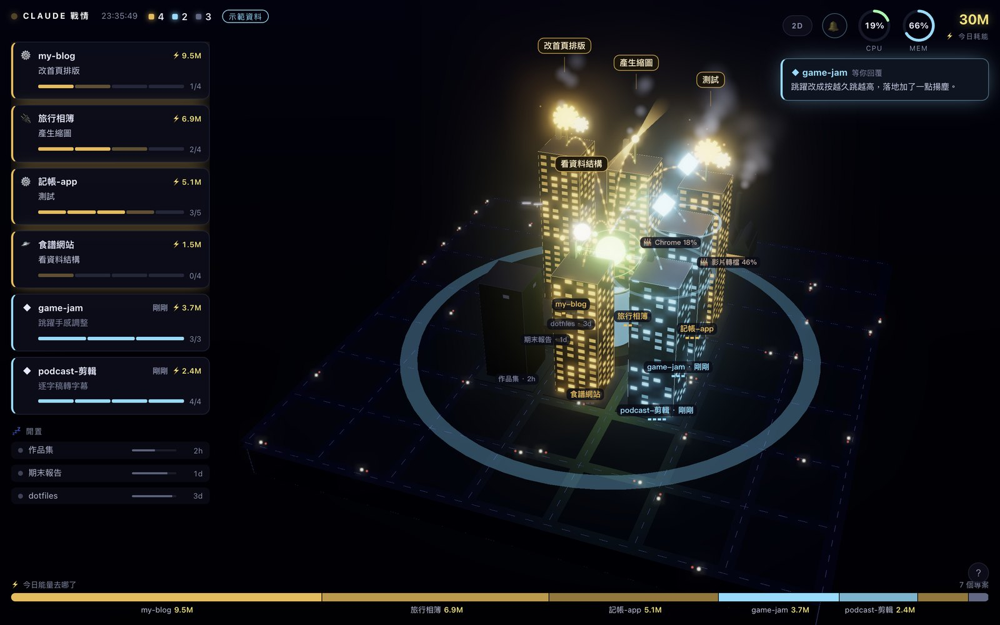
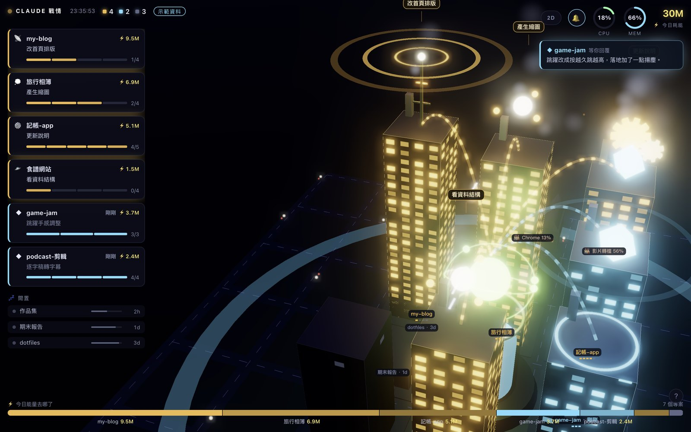
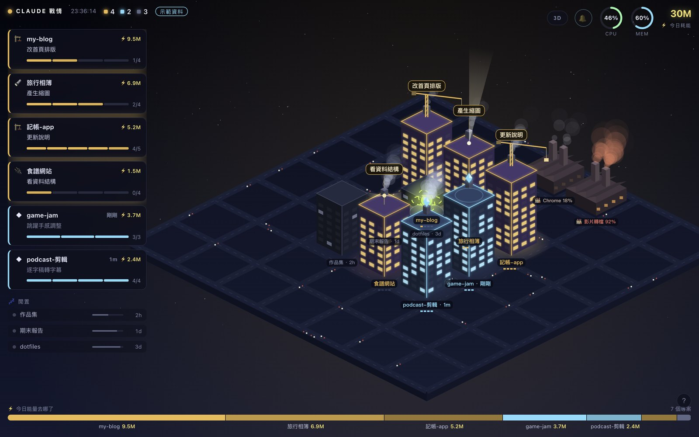
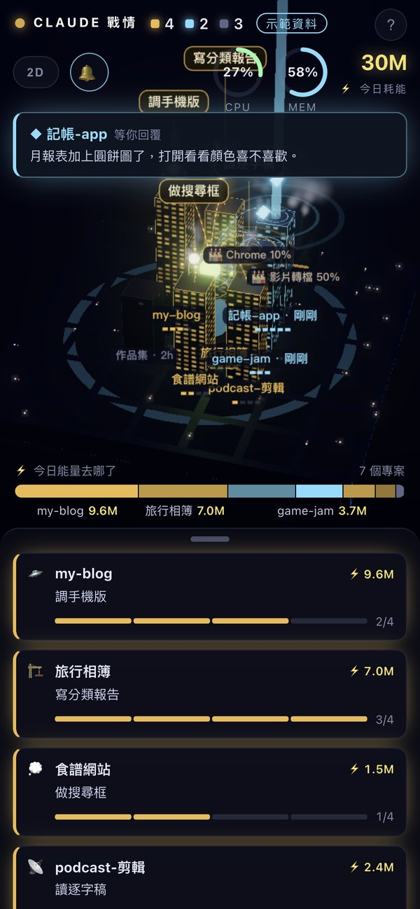

<p align="center"></p>

<h1 align="center">Claude 戰情城</h1>

<p align="center">把你所有的 Claude Code 對話，變成一座會動的夜晚城市。<br>
哪個在工作、哪個在等你回覆、今天的 token 花到哪裡，一眼就看得出來。</p>



---

## 這是什麼

同時開好幾個 Claude Code 對話時，很容易忘記哪個做完了、哪個卡在等你回覆。
戰情城會讀取 Claude Code 存在你電腦裡的對話紀錄，把每個專案畫成一棟大樓：

- **一棟大樓 = 一個專案資料夾**
- **大樓越高 = 今天在這個專案用掉越多 token**
- **顏色 = 狀態**：🟧 工作中　🟦 等你回覆　⬛ 閒置（越久沒動，燈越暗）
- **屋頂動畫 = AI 正在做的事**：跑指令、改檔案、讀檔搜尋、上網、派分身……
- **煙囪冒煙 = 這個對話正在吃你電腦多少 CPU**

AI 做完、輪到你的時候，畫面上方會滑下一張大橫幅，點一下就跳回那個對話。

> 全部在你自己的電腦上跑。不上傳任何資料，也不需要 API 金鑰。

## 功能一覽

| | |
|---|---|
|  |  |
| **3D 城市**：拖曳旋轉、滾輪縮放，點大樓飛過去看細節，雙擊回到全景 | **2D 版**：右上角一鍵切換，3D 跑不動的電腦會自動改用 2D |

- **左側清單**：工作中和等你回覆的對話各一張卡，寫著正在做什麼、進度幾項；下面列出閒置的專案和閒置多久。
- **底部能量條**：今天的 token 花在哪些專案、各占多少。
- **中央電廠**：整台電腦的 CPU 和記憶體用量。
- **城市邊緣的工廠**：其他特別吃 CPU 的 App（例如正在轉檔的剪輯軟體）。
- **進度**：對話裡有用到待辦清單（TodoWrite、TaskCreate）的，大樓旁邊會顯示完成幾項／共幾項。

### Mac 選單列常駐（選用）


- 選單列圖示旁邊直接顯示 **●工作中幾個 ◆等你回覆幾個**。
- 點圖示，戰情城從上方掉下來；按 **⌃⌥C** 隨時叫出或收起。
- **做完就提醒你**：某個對話從「工作中」變成「等你回覆」時，螢幕上方滑下大橫幅、所有螢幕四邊閃一圈光、播放提示音，20 秒後自動收起。
- **點橫幅直接跳回那個對話**（Claude 桌面版 App 的 Code 分頁）。在終端機跑的對話則會打開戰情城。
- 你自己按「停止」打斷 AI 的，不會提醒。

### 用手機看（選用）



手機版是直式版面：城市在上、清單在下，可以「加入主畫面」當成一個 App。
搭配 [Tailscale](https://tailscale.com)，出門在外用行動網路也能看。

## 支援的電腦

| 功能 | Mac | Windows／Linux |
|---|:---:|:---:|
| 3D／2D 城市、清單、能量條、網頁叮咚提醒 | ✅ | ✅ |
| 煙囪（各對話吃多少 CPU）、工廠 | ✅ | — |
| 選單列常駐、大橫幅提醒、點了跳回對話 | ✅ | — |
| 用手機看 | ✅ | — |

> 主要在 macOS 上開發和測試。Windows、Linux 只有網頁版，有問題歡迎回報。

## 需要準備

1. **[Claude Code](https://claude.com/claude-code)**：終端機版或 Claude 桌面版 App 的 Code 分頁都可以，而且最近 7 天內用過，城市裡才會有大樓。
2. **[Node.js](https://nodejs.org) 18 以上**：到官網下載 LTS 版安裝即可，不用裝任何套件。
3. （只有選單列 App 需要）**Xcode Command Line Tools**：在終端機輸入 `xcode-select --install`。
4. 一個支援 WebGL 的瀏覽器：Chrome、Safari、Edge、Firefox 都可以。

## 開始使用

先把這個資料夾下載下來：在這個頁面上方按綠色的 **Code → Download ZIP**，再解壓縮。會用 git 的話也可以：

```bash
git clone https://github.com/da33/claude-war-room-city.git
```

### 1. 先看示範（不會讀你的資料）

打開終端機，進到資料夾，輸入：

```bash
node server.js --demo
```

再用瀏覽器打開 <http://localhost:5178>。這是一座假資料的城市，左上角會標「示範資料」，適合先看看長怎樣或拿來截圖。

### 2. 看你自己的城市

- **Mac**：雙擊 `啟動戰情城.command`
- **Windows**：雙擊 `啟動戰情城.bat`

會自動打開瀏覽器到 <http://localhost:5177>。不用的時候，把跳出來的終端機視窗關掉就停止了。

> Mac 第一次雙擊時，如果出現「Apple 無法驗證……」而打不開：打開 **系統設定 → 隱私權與安全性**，拉到最下面，在被擋下的檔案旁按 **強制打開**。
> 也可以不用雙擊，直接在終端機進到資料夾輸入 `node server.js`，再打開 <http://localhost:5177>。

### 3. 裝選單列 App（Mac，選用）

在終端機進到資料夾，輸入：

```bash
zsh mac/build.sh
```

它會在你的電腦上編譯，裝到 `~/Applications/Claude 戰情城.app` 並自動打開。之後就不用再雙擊啟動檔，App 會自己在背景啟動伺服器。

- **右鍵**選單列圖示：用瀏覽器開大視窗、用手機看、預覽提醒、釘住面板、登入時自動開啟、結束。
- 「**登入時自動開啟**」預設不勾，想要開機就出現，自己勾起來。
- 編譯好的 App 會記住這個資料夾的位置。**之後如果搬了資料夾，要再跑一次 `zsh mac/build.sh`**。
- 也可以用網址控制（給捷徑、Raycast、Stream Deck 用）：`claude-warroom://show`、`hide`、`toggle`、`test`（預覽提醒）、`phone`（用手機看）。

### 4. 用手機看（選用）

手機連線**預設關閉**。要用的時候：

1. 右鍵選單列圖示 → **用手機看（掃 QR code）**，會打開手機連線並跳出 QR code。
2. 用手機相機掃描，打開後按「分享 → 加入主畫面」。
3. 手機要和 Mac 連同一個 Wi-Fi。想在外面也能看：Mac 和手機都裝 [Tailscale](https://tailscale.com) 並登入同一個帳號，QR code 會自動改用 Tailscale 的網址。
4. 不用時，右鍵 → **關閉手機連線**。

## 圖例

| 你看到的 | 意思 |
|---|---|
| 🟧 橘色大樓、窗戶全亮 | 工作中：AI 正在跑工具，或剛收到你的訊息 |
| 🟦 藍色大樓、慢慢閃 | 等你回覆：AI 回答完了，3 小時內還沒動 |
| ⬛ 灰暗大樓 | 閒置；燈越暗，閒置越久（超過 7 天就不顯示） |
| 大樓高度 | 今天的「能量」（見下方） |
| ⚙️ 屋頂齒輪 | 跑指令 |
| 🏗️ 屋頂吊車 | 改檔案 |
| 🔦 探照燈 | 讀檔、搜尋 |
| 📡 衛星天線 | 上網 |
| 🛸 飛碟 | 派出分身（subagent） |
| 💭 思考泡泡 | 正在想、整理待辦 |
| 🔌 插頭 | 外掛工具（MCP） |
| 💨 煙囪冒煙 | 這個對話正在吃本機 CPU |
| ⚡ 電線上的光點 | 正在消耗 token |
| 🏭 城市邊緣的工廠 | 其他吃 CPU 的 App |
| ⚛️ 中央電廠 | 這台電腦（核心顏色＝CPU，水位＝記憶體） |

網頁右下角的 **?** 隨時可以叫出圖例。

### 「能量」怎麼算

不同種類的 token 成本差很多，所以照比例加權：

```
能量 = 輸入 + 快取寫入 × 1.25 + 快取讀取 × 0.1 + 輸出 × 5
```

它是用來比較「哪個專案比較耗」的相對數字，**不是你的帳單金額**。

## 隱私與安全

- **只讀不改**：只會讀 `~/.claude/projects/` 裡的對話紀錄，絕不修改或刪除。
- **資料不出你的電腦**：沒有任何上傳、統計或追蹤。伺服器預設只讓這台電腦自己連（`127.0.0.1`）。
- **唯一的對外連線**：網頁會從 jsDelivr CDN 載入 3D 函式庫 three.js（固定版本 0.169.0），不會送出任何你的資料。
- **手機連線**：要你自己按「用手機看」才會打開。打開後，其他裝置必須帶著隨機產生的密鑰才看得到，第一次用 QR code 的網址，之後靠 cookie；而且只接受 IP、`localhost`、`.local` 網址，其他網域一律擋掉。
- **密鑰存在 `.env`**，不會寫在程式碼裡。想讓所有已連過的手機失效：刪掉 `.env` 裡 `WARROOM_KEY` 那一行，重新啟動就會換一組新的。
- **Mac 上另外會讀**：用 `ps`、`lsof` 查 Claude 程式在哪個資料夾、吃多少 CPU；為了「點橫幅跳回對話」，會讀 Claude App 的 `~/Library/Application Support/Claude/claude-code-sessions/` 裡每個檔案的開頭。

執行後會在資料夾裡產生這幾個檔案，裡面有你的專案路徑或密鑰，**請不要分享出去**（已經寫進 `.gitignore`）：

| 檔案 | 內容 |
|---|---|
| `.env` | 手機連線的密鑰 |
| `settings.json` | 提醒、手機連線的開關 |
| `city-layout.json` | 每棟大樓的位置（含專案路徑） |

## 常見問題

**城市空空的、一棟大樓都沒有？**
最近 7 天要有用過 Claude Code。第一次打開要等幾秒讀取紀錄。可以先跑 `node server.js --demo` 確認畫面正常。

**數字跟我的帳單對不起來？**
「能量」是加權過的 token 數，用來比較專案之間的比例，不是金額。

**點橫幅沒有跳到對話，而是打開戰情城？**
只有 Claude 桌面版 App 的 Code 分頁裡的對話能直接跳回去；在終端機跑的對話沒辦法，就會打開戰情城。

**選單列 App 打開後是空的？**
通常是找不到 Node.js，App 會跳出提示。裝好 Node.js 後重新打開 App。紀錄檔在 `~/Library/Logs/ClaudeWarRoom.log`。

**5177 這個埠已經被別的程式用了？**
換一個埠啟動：`PORT=5300 node server.js`，再打開 <http://localhost:5300>。

**Claude Code 更新之後怪怪的？**
戰情城讀的是 Claude Code 沒有正式公開的紀錄格式和 App 內部資料，Claude 改版時可能會失效，歡迎回報。

## 解除安裝

1. 右鍵選單列圖示 → **結束 Claude 戰情城**（如果有勾「登入時自動開啟」，先取消勾選）。
2. 刪掉 `~/Applications/Claude 戰情城.app`。
3. 刪掉 `~/Library/Logs/ClaudeWarRoom.log`。
4. 刪掉這個資料夾。

不會在其他地方留下東西，也不會動到 Claude Code 的任何檔案。

## 檔案結構

```
server.js              讀紀錄、算狀態，提供網頁和 /api/state（只用 Node.js 內建功能）
public/                網頁本身：index.html、shared.js、city3d.js（three.js）、city2d.js
mac/WarRoom.swift      選單列 App（Swift / AppKit）
mac/build.sh           編譯並安裝選單列 App
啟動戰情城.command     Mac 雙擊啟動
啟動戰情城.bat         Windows 雙擊啟動
docs/                  說明文件用的圖片
```

## 致謝與授權

- 3D 畫面使用 [three.js](https://threejs.org)（MIT 授權）。
- 本專案以 [MIT 授權](LICENSE) 釋出，可以自由使用、修改、分享。

> 本專案是個人作品，與 Anthropic 無關，也不是官方產品。Claude 是 Anthropic 的商標。

---

<details>
<summary>English</summary>

**Claude 戰情城 (Claude War Room City)** turns all your Claude Code sessions into an animated night city.
One building per project folder; height = today's cost-weighted tokens; orange = working, blue = waiting for you, grey = idle; roof animations show the current tool; chimney smoke shows CPU.
A macOS menu bar app adds a big "your turn" banner that jumps straight back to the conversation, and an optional phone view (same Wi-Fi or Tailscale, protected by a secret key).
Everything runs locally from your own transcripts in `~/.claude/projects` (read-only), using only Node.js built-ins.

Try it: `node server.js --demo`, then open http://localhost:5178. The UI is in Traditional Chinese.
</details>
